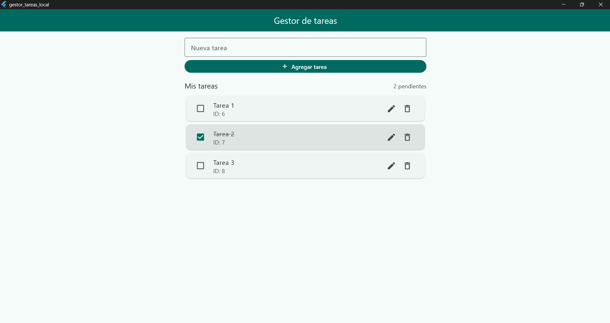
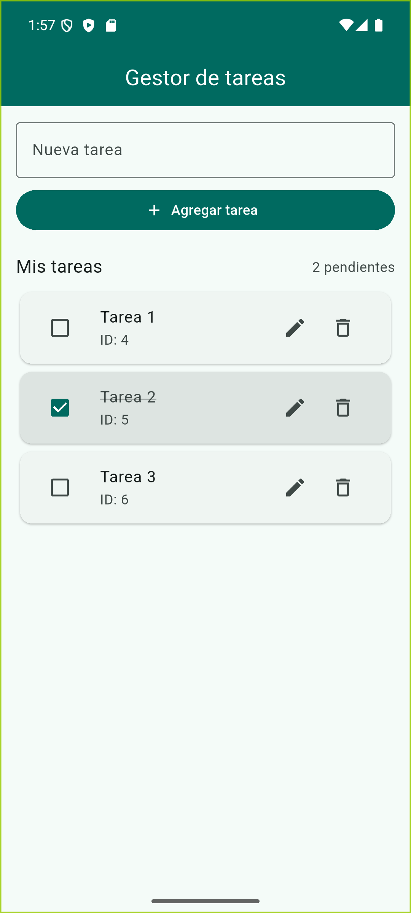
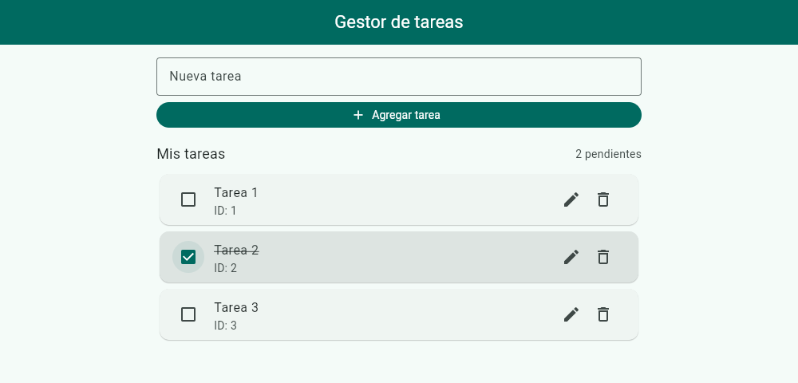

# Gestor de tareas local

App Flutter que guarda las tareas en una base SQLite del propio dispositivo, sin servidor. Las tareas siguen ahí después de cerrar y volver a abrir la app. Práctica de Programación de Dispositivos Móviles.

## Qué hace
Agrega tareas (no acepta títulos vacíos ni de solo espacios), las lista, edita el título, las marca como completadas o pendientes y las elimina.

## Cómo ejecutarlo
En Windows:
```
flutter pub get
flutter run -d windows
```
En Android, con el emulador encendido (el identificador sale de `flutter devices`):
```
flutter run -d emulator-5554
```
En el navegador:
```
flutter run -d web-server --web-port 5000
```
Después se abre `http://localhost:5000`. Se usa siempre el mismo puerto porque en web los datos pertenecen al origen (dirección y puerto) y otro puerto sería otro origen.

El archivo `lib/data/database.g.dart` está en el repo, así que basta con `flutter pub get`. Si se cambia la tabla, se regenera con:
```
dart run build_runner build
```

## Persistencia
Uso Drift con `drift_flutter`. Con un mismo código funciona en web, móvil y escritorio. `sqflite` no cubre web ni escritorio por sí solo, y la consigna no acepta una lista en memoria ni guardar JSON en `shared_preferences`.

Después de cada escritura (agregar, editar, cambiar el estado o eliminar) la pantalla vuelve a consultar la tabla con un `Future` y actualiza la lista con `setState`. La consulta está en `_cargarTareas()` y no dentro de `build()`. El acceso a la base está en `lib/data/tareas_repository.dart`.

## Tabla `tareas`
| Columna | Tipo en SQLite | Restricciones |
|---|---|---|
| `id` | INTEGER | llave primaria, autoincremental |
| `titulo` | TEXT | no nulo |
| `completada` | INTEGER (0 o 1) | no nulo, por defecto 0 |

Edición y eliminación van por `id`, no por la posición en la lista. El título se recorta con `trim()` y se rechaza si queda vacío; esa validación está en la app y no en la tabla.

## Dónde se guarda la base
- **Windows:** archivo `gestor_tareas.sqlite` en la carpeta Documentos del usuario.
- **Android:** archivo `gestor_tareas.sqlite` en la carpeta privada de la app (`app_flutter`), a la que otras apps no tienen acceso.
- **Web:** almacenamiento del navegador, ligado al origen. Se necesitan `web/sqlite3.wasm` y `web/drift_worker.dart.js`, tomados del release `drift-2.35.4` de Drift, la misma versión que usa `pubspec.lock`. Si se actualiza `drift`, hay que actualizar también esos dos archivos.

## Plataformas
El código está pensado para Android, iOS, Windows, Linux, macOS y web. Probé tres, una por entorno:

| Entorno | Plataforma probada | Estado |
|---|---|---|
| Escritorio | Windows 11 | Probada (P1 a P5) |
| Móvil | Android 15 (API 35), en el emulador Pixel 8 | Probada (P1 a P5) |
| Web | Navegador, en `localhost:5000` | Probada (P6) |

iOS, Linux y macOS quedan sin probar. Android se probó solo en emulador, no en un teléfono físico.

## Capturas
Windows:



Android, en el emulador:



Web:



Los `ID` de cada captura son distintos porque cada plataforma tiene su propia base y el `id` es autoincremental: no se reutilizan los números de las tareas que ya se habían borrado en pruebas anteriores.

## Pruebas manuales
| ID | Qué hice | Windows | Android | Web |
|---|---|---|---|---|
| P1 | Agregué 3 tareas, cerré la app y la volví a abrir | Pasó: las 3 siguieron ahí | Pasó: las 3 siguieron ahí | - |
| P2 | Marqué una tarea como completada y reinicié | Pasó: conservó el estado | Pasó: conservó el estado | - |
| P3 | Cambié el título de una tarea y reinicié | Pasó: apareció el título nuevo | Pasó: apareció el título nuevo | - |
| P4 | Eliminé una tarea y reinicié | Pasó: no reapareció | Pasó: no reapareció | - |
| P5 | Intenté agregar un título vacío y otro de solo espacios | Pasó: no se agregaron y salió un mensaje | Pasó: no se agregó en ninguno de los dos casos | - |
| P6 | Agregué tareas, recargué la página y cerré y abrí la pestaña en `localhost:5000` | - | - | Pasó: las tareas permanecieron |

## Pruebas automáticas
```
flutter test
```
Son 8 pruebas. La de `test/widget_test.dart` viene en la base del profe. Las otras 7 están en `test/tareas_repository_test.dart` y usan una base en memoria: agregar, recortar espacios, rechazar títulos vacíos, editar, cambiar el estado y eliminar por `id`. La última cierra la base, la vuelve a abrir desde el archivo y comprueba que la tarea sigue ahí.
